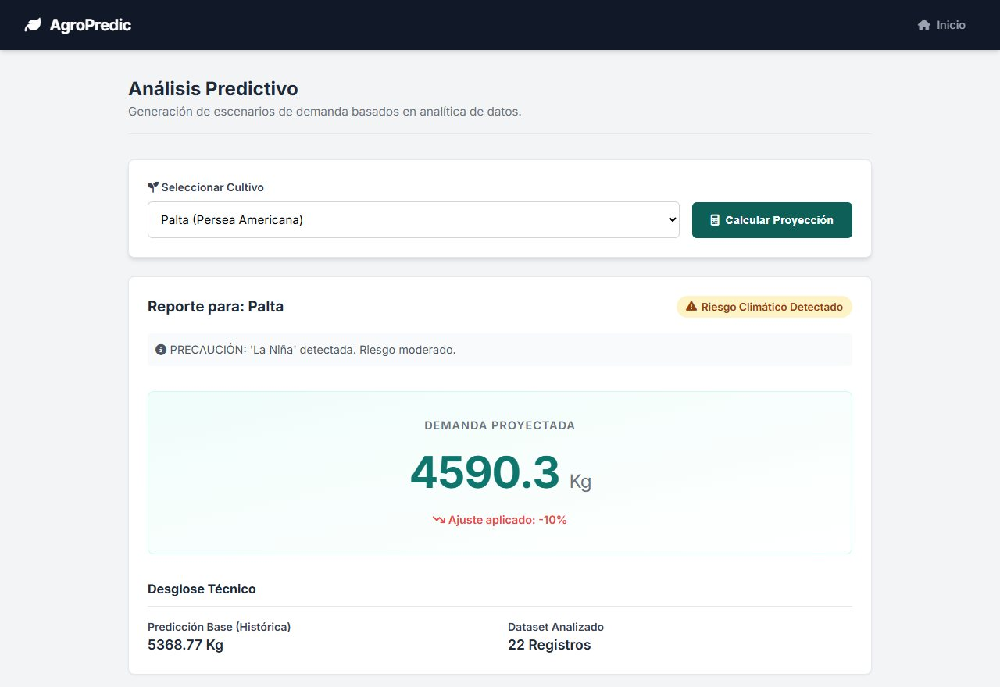
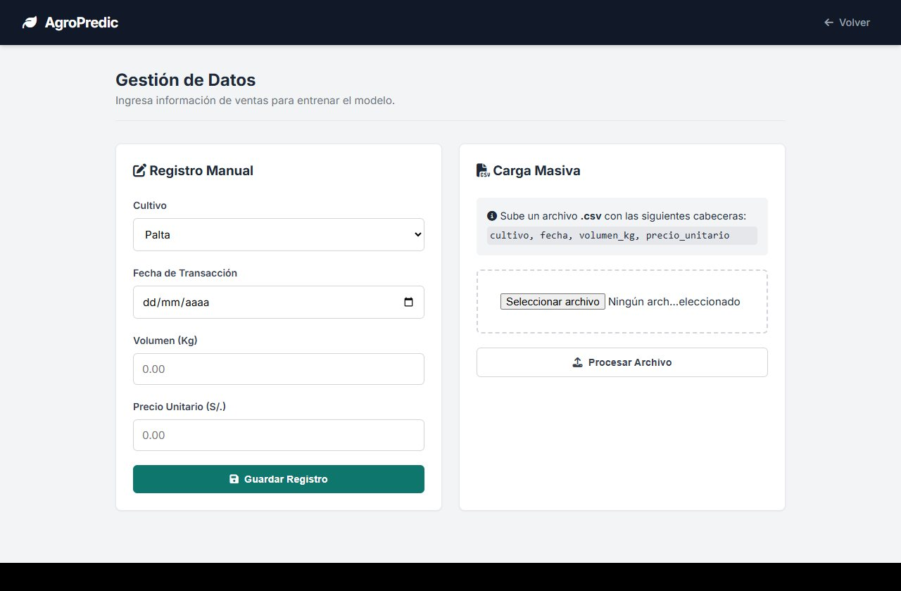
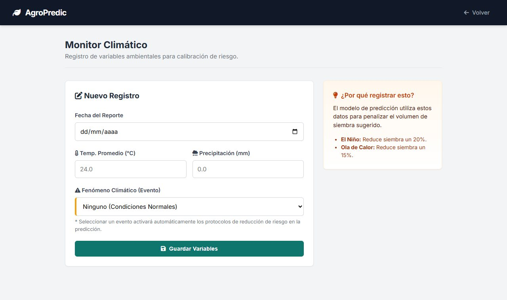

# AgroPredic

App web en Flask que estima cuántos kilos conviene producir de palta, mango y arándanos. Parte de las ventas históricas de cada cultivo y ajusta el resultado según el último registro climático, para no sembrar de más cuando hay riesgo.

La hice para el curso de Calidad de Software de la UNSA en 2025, así que buena parte del trabajo estuvo en las pruebas y el análisis de calidad.



## Cómo calcula la predicción

1. Toma las ventas del cultivo en orden de fecha y saca un promedio ponderado: cada registro pesa más que el anterior, así que los datos recientes cuentan más.
2. Compara la última venta con el promedio simple. Si está por encima, sube el resultado un 5 %; si está por debajo, lo baja un 5 %.
3. Mira el último registro de clima. El Niño reduce la cifra un 20 %, una ola de calor (o más de 30 °C) un 15 % y La Niña un 10 %.

El código está en `predictor.py`.

## Pantallas

El panel de inicio lleva a las tres partes de la app: el registro de ventas, el monitor climático y la predicción.


Las ventas se pueden registrar una por una o subir en bloque con un CSV de columnas `cultivo, fecha, volumen_kg, precio_unitario`. También hay un reporte de todas las ventas listo para imprimir.



En el monitor climático se guarda la temperatura, la precipitación y el fenómeno del momento.



## Pruebas

`tests.py` tiene 7 pruebas con `unittest`: que la web responda, que se guarden los datos, la tendencia de mercado y los escenarios de El Niño, La Niña, ola de calor y clima normal. El análisis estático se hizo con SonarQube.

```
python tests.py
```

## Ejecutarlo

```
python -m venv venv
venv\Scripts\activate
pip install flask pandas
python setup_db.py
python app.py
```

La app queda en `http://127.0.0.1:5000`. El repositorio ya trae `cultivos.db` con datos de ejemplo. `setup_db.py` crea las tablas si no existen, y `datos_full.csv` sirve para probar la carga masiva.
